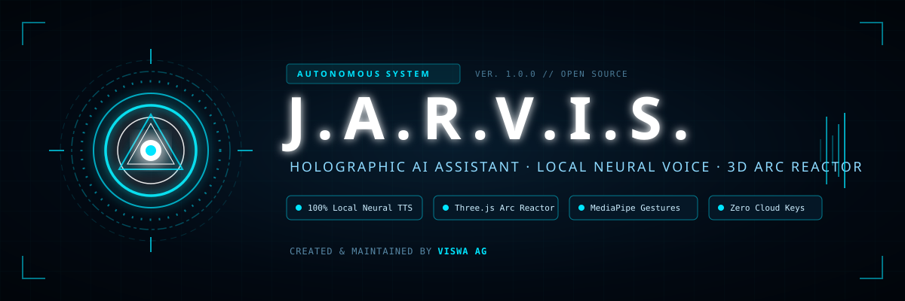

<p align="center">
  
</p>

<p align="center">
  <a href="https://github.com/viswafc/JARWIS_OPEN/actions/workflows/ci.yml"></a>
  <a href="https://github.com/viswafc/JARWIS_OPEN/releases"></a>
  <a href="LICENSE"></a>
  <a href="https://github.com/viswafc"></a>
  <a href="https://nodejs.org/"></a>
  <a href="https://www.w3.org/TR/webgpu/"></a>
</p>

<p align="center">
  <strong>Just A Rather Very Intelligent System</strong> — An open-source autonomous holographic AI assistant created by <strong>Viswa AG</strong>.<br/>
  Featuring a procedural 3D Arc Reactor interface, 100% local neural voice synthesis, wake-word activation, real-time hand gesture tracking, and complete system execution.
</p>

---

## Architecture

```
                               ┌──────────────────────────────────────────────┐
                               │             USER INTERACTION                 │
                               │   Speech ("Hey Jarvis") · Gestures · Keys    │
                               └──────────────────────┬───────────────────────┘
                                                      │
                                                      ▼
 ┌────────────────────────────────────────────────────────────────────────────────────────────────────────┐
 │                                              FRONTEND FACE                                             │
 │                                  (React 19 · Vite · Three.js · WebGL)                                  │
 │                                                                                                        │
 │  ┌───────────────────────┐   ┌────────────────────────┐   ┌─────────────────────────────────────────┐  │
 │  │      ARC REACTOR      │   │   NEURAL VOICE (TTS)   │   │             VISION & SENSORS            │  │
 │  │ 3D Procedural Meshes  │   │   Kokoro 82M (ONNX)    │   │  MediaPipe Hand Tracking (WASM)         │  │
 │  │ Dynamic GLSL Shaders  │   │   WebGPU / WASM Local  │   │  Porcupine Wake-word Engine             │  │
 │  │ Audio Amplitude HUD   │   │   Zero Cloud API Keys  │   │  Continuous Speech Recognition          │  │
 │  └───────────────────────┘   └────────────────────────┘   └─────────────────────────────────────────┘  │
 └────────────────────────────────────────────────────┬───────────────────────────────────────────────────┘
                                                      │
                                         WebSocket (ws://127.0.0.1:8787)
                                         Fast Bidirectional Stream
                                                      │
                                                      ▼
 ┌────────────────────────────────────────────────────────────────────────────────────────────────────────┐
 │                                            INTELLIGENCE BRIDGE                                         │
 │                                   (Node.js Daemon · Antigravity Engine)                                │
 │                                                                                                        │
 │  ┌───────────────────────┐   ┌────────────────────────┐   ┌─────────────────────────────────────────┐  │
 │  │     CORE REASONING    │   │      TOOL POLICY       │   │           INTERFACE PROTOCOL            │  │
 │  │  Antigravity Runtime  │   │  Full Writes Enabled   │   │  Real-time Token Streaming              │  │
 │  │  Gemini Flash Engine  │   │  Safe Execution Roots  │   │  Dynamic Blades & Card Overlays         │  │
 │  │  Conversation Memory  │   │  Terminal & Filesystem │   │  Holographic Theme & Color Retinting    │  │
 │  └───────────────────────┘   └────────────────────────┘   └─────────────────────────────────────────┘  │
 └────────────────────────────────────────────────────────────────────────────────────────────────────────┘
```

---

## Key Features

- **🎙️ 100% Local Neural Voice**: Powered by **Kokoro 82M ONNX** running directly inside your browser via **WebGPU** (with automatic WASM/CPU fallback). No ElevenLabs or cloud voice API keys required.
- **⚡ 3D Holographic Arc Reactor**: Built with Three.js and custom GLSL shaders, reacting in real-time to speech audio frequency and volume.
- **🗣️ Wake-Word Recognition**: Always-ready acoustic trigger with **"Hey Jarvis"** or push-to-talk with <kbd>Spacebar</kbd>.
- **🖐️ Vision & Gesture Control**: Offline hand landmark tracking with vendored MediaPipe WebAssembly. Pinch, drag, focus, and close holographic blade cards in mid-air.
- **🧠 Local Intelligence Bridge**: Powered by Antigravity runtime with multi-turn conversation memory, live token streaming, and heartbeat keepalive.
- **🛠️ Full System Autonomy**: Enabled write permissions (`JARVIS_ALLOW_WRITES=1`) allowing JARVIS to read/write files, run shell commands, perform web research, and alter its own theme dynamically.

---

## Getting Started

### Prerequisites

- **Node.js 20 or newer** ([nodejs.org](https://nodejs.org/))
- **Google Chrome** or **Microsoft Edge** (for WebGPU and Web Speech API support)

### Installation

```bash
# Clone the repository
git clone https://github.com/viswafc/JARWIS_OPEN.git
cd JARWIS_OPEN

# Install dependencies
npm install

# Run preflight setup verification
npm run setup
```

### Starting the Assistant

To launch both the Intelligence Bridge and the Frontend Dev Server concurrently:

```bash
npm start
```

1. Open your browser to **`http://localhost:5173`** (use a standard browser window, not an editor iframe, so microphone permissions are granted).
2. Click **INITIALISE** in the centre of the Arc Reactor.
3. Allow **Microphone Access** when prompted.
4. On first launch, the browser will download and cache the local neural voice weights (~86 MB).
5. Say **"Hey Jarvis"** or tap <kbd>Spacebar</kbd> to begin conversing!

---

## Operating Controls

| Key / Trigger | Action | Description |
| :--- | :--- | :--- |
| **"Hey Jarvis"** | Voice Activation | Wakes the assistant to listen and respond. |
| <kbd>Spacebar</kbd> | Push-to-Talk | Hold or tap to speak immediately without the wake-word. |
| <kbd>Escape</kbd> | Barge-in / Interrupt | Immediately cuts off speech and cancels the active turn. |
| <kbd>G</kbd> | Gesture Control | Toggles camera-based hand tracking on/off. |
| <kbd>V</kbd> | Voice Engine | Toggles/cycles through local neural voice options. |
| <kbd>D</kbd> | Diagnostic HUD | Displays real-time audio, microphone, and socket telemetry. |

---

## Example Spoken Commands

- *"What files are in this workspace?"*
- *"Change theme to emerald and style the reactor as wireframe."*
- *"Look up the latest developments in quantum computing and summarize them."*
- *"Create a new project note file in this folder."*
- *"What is your current system status?"*

---

## Configuration

Settings can be customized in `.env.local`:

```ini
# Backend connection
VITE_BACKEND=bridge
VITE_BRIDGE_URL=ws://localhost:8787

# Intelligence model
JARVIS_MODEL=gemini-3.8-flash-medium

# Local neural voice
VITE_TTS_ENGINE=kokoro
VITE_KOKORO_VOICE=bm_george
VITE_USE_ELEVENLABS=false

# System permissions
JARVIS_ALLOW_WRITES=1
```

---

## Project Structure

```
JARWIS/
├── bridge/                 # Node.js backend bridge
│   ├── server.mjs          # WebSocket server & policy engine
│   ├── agy.mjs             # Antigravity engine adapter & stream handler
│   ├── policy.mjs          # Tool safety & file sandbox enforcement
│   └── net.mjs             # SSRF-safe network & media proxy
├── src/                    # Frontend holographic interface
│   ├── components/         # 3D Arc Reactor (Three.js & GLSL shaders)
│   ├── lib/                # Audio, Kokoro TTS, Porcupine VAD, & bridge client
│   └── ui/                 # HUD overlays, Blades, Gestures, & telemetry
├── public/                 # Static assets & vendored MediaPipe WASM
├── scripts/                # Launchers & diagnostic preflight scripts
└── package.json            # Project manifest
```

---

## Author

**Viswa AG**
- GitHub: [@viswafc](https://github.com/viswafc)
- Repository: [viswafc/JARWIS_OPEN](https://github.com/viswafc/JARWIS_OPEN)

---

## License

This project is licensed under the [MIT License](LICENSE) © 2026 **Viswa AG**.
